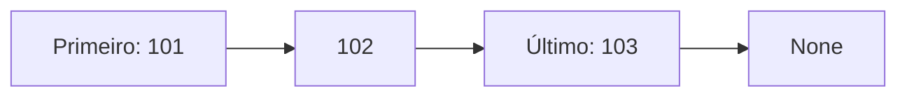

# S3_03 — Filas e listas encadeadas

A fila segue FIFO: o primeiro ativo colocado é o primeiro retirado. FilaLista usa append e pop(0). A retirada no início desloca os demais elementos, custando O(n). FilaDeque usa append e popleft, com O(1) nas extremidades. As duas recusam retirada de uma fila vazia com IndexError.

ListaEncadeada mantém No(valor, proximo), primeiro e ultimo. Inserir no final é O(1) porque ultimo já aponta para o último nó. Remover por valor e percorrer custam O(n). A remoção ajusta primeiro e ultimo, inclusive quando sobra nenhum nó. A lista Python oferece acesso por índice O(1), enquanto localizar um índice na lista encadeada exige percorrer nós.

Na fila, entra 101, depois 102 e 103; sai 101, 102 e 103. No encadeamento, retirar 102 faz o nó 101 apontar para 103. Arquivo sprint3/s3_03.py; saída evidencias/s3_03.txt. Os testes verificam FIFO, fila vazia e remoção no início, meio e final.
