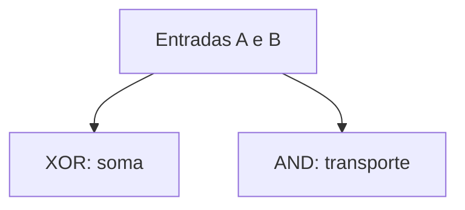

# S3_14 — Portas lógicas e arquitetura

AND produz 1 apenas com duas entradas 1; OR produz 1 com alguma entrada 1; NOT inverte. NAND e NOR negam AND e OR. XOR produz 1 quando as entradas diferem; XNOR, quando são iguais. s3_14.py produz a tabela para 00, 01, 10 e 11.

Um meio somador usa soma=A XOR B e transporte=A AND B. Em 1+1, soma é 0 e transporte 1, representando 10 em binário. Um multiplexador de duas entradas usa saída=(¬S∧A)∨(S∧B); com S=0 escolhe A, com S=1 escolhe B. A lei da absorção simplifica A∨(A∧B) para A.

Na arquitetura de Von Neumann, instruções e dados compartilham a memória. A CPU inclui unidade de controle, unidade lógica e aritmética e registradores. Barramentos transportam dados, endereços e controle. Entrada e saída conectam periféricos. O ciclo busca a instrução pelo contador de programa, decodifica, executa e atualiza o estado. O programa simula os circuitos booleanos e os testes percorrem todas as entradas; não há alegação de montagem física.
