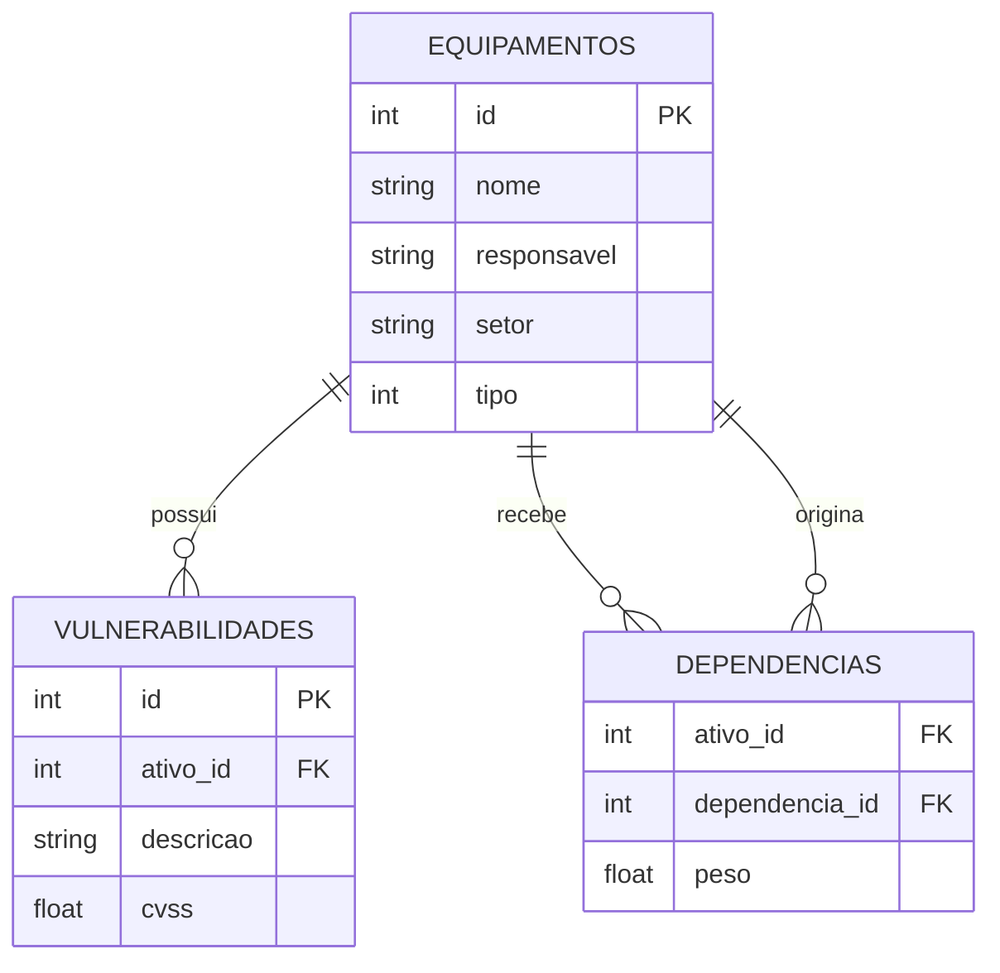

# S3_19 — Backend e persistência

O backend é Flask. A fábrica criar_app permite trocar caminho da base e token nos testes. O serviço lê a base, aplica a operação e salva em uma transação; falha não deixa alterações parciais. Uma versão da base detecta tentativa de sobrescrever uma gravação concorrente. Gunicorn usa um worker e quatro threads; o serviço mantém uma trava durante alterações.

schema.sql cria as tabelas normalizadas. IDs são chaves primárias; ativo_id e dependencia_id são chaves estrangeiras. Excluir um ativo remove seus vínculos. Queries usam parâmetros ? e não concatenam o nome digitado. Uma string parecida com SQL permanece um nome, verificado em teste.

Exemplos de consulta estão em consultas.sql. O CRUD do terminal salva uma lista JSON em dados/equipamentos.json; a API guarda tabelas SQLite em dados/inventario.db. São bases diferentes. Para trocar dados, use a exportação/importação em JSON. O requisito de lista JSON do Trabalho 02 é atendido pelo modo terminal; a versão SQL é uma extensão para estudar backend. Não foi afirmado que cada linha SQL guarda um objeto JSON literal.
